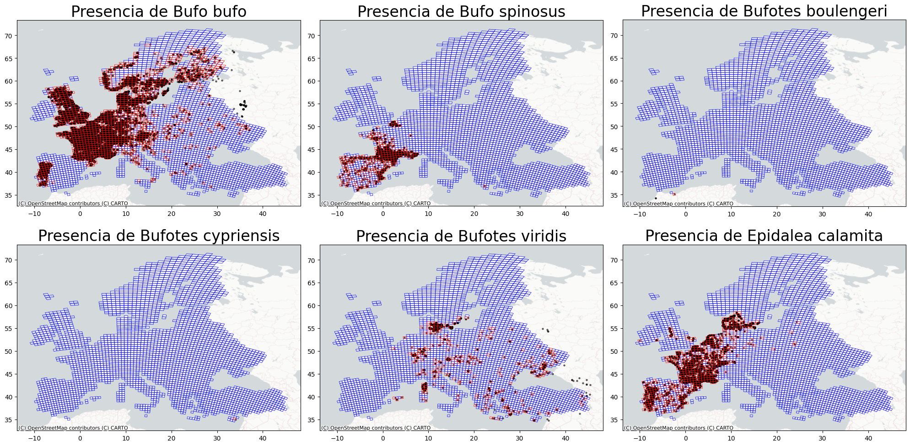
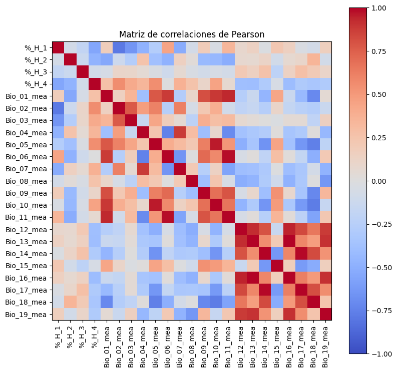
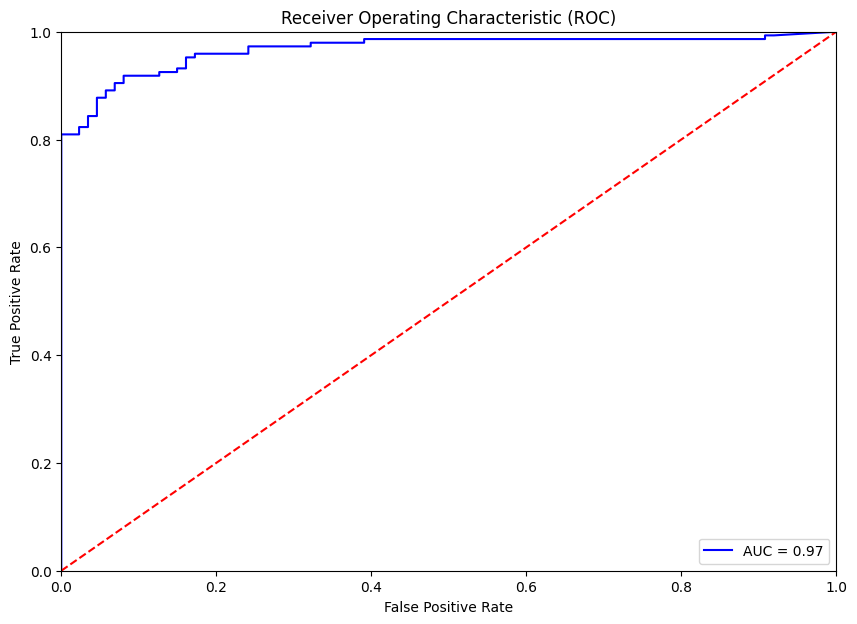
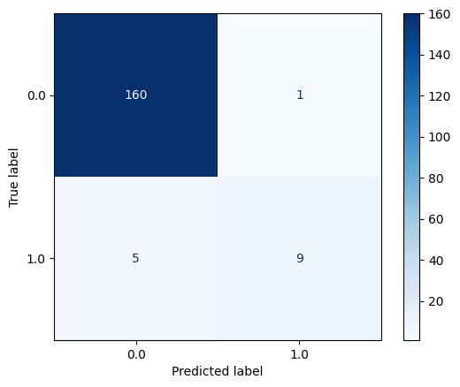
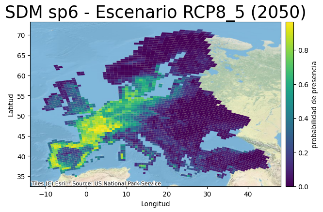
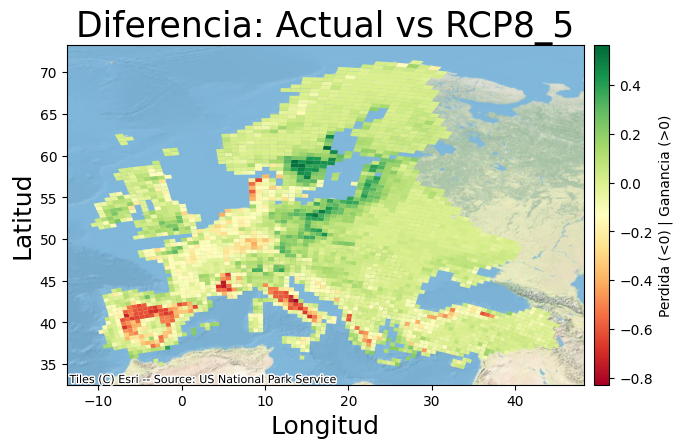

# Modelización de la distribución de especies de sapos europeos

[English](README.md) | **[Español](README.es.md)**

**Python | R | Machine Learning | Análisis geoespacial**

Trabajo Fin de Máster en Data Science y Business Analytics - IFM Smart Education - Septiembre de 2024

Autora: **Mónica Gómez Vadillo**

Proyecto de ciencia de datos aplicada a la ecología que combina observaciones de biodiversidad, variables climáticas y datos de usos del suelo para modelizar tres especies de sapos europeos mediante clasificadores Random Forest.

> **Estado del proyecto:** Este repositorio conserva el código original y las salidas guardadas de un Trabajo Fin de Máster de septiembre de 2024. La actualización posterior de su presentación añade documentación y extrae figuras existentes; no vuelve a ejecutar ni revalida científicamente los modelos. Los mapas de 2050 son salidas de modelos bajo escenarios, no predicciones validadas de ocupación futura. La reproducción requiere datos externos y procesamiento manual en QGIS.

[Pregunta de investigación y flujo](#pregunta-de-investigación-y-flujo-de-procesamiento) - [Resultados históricos](#resultados-originales) - [Guía de notebooks](#guía-de-notebooks) - [Reproducibilidad](docs/reproducibility.md) - [Limitaciones](docs/limitations.md)

## Pregunta de investigación y flujo de procesamiento

**¿Cómo difieren las distribuciones modelizadas de los bufónidos europeos entre un escenario histórico de referencia y dos escenarios climáticos y de usos del suelo para 2050?**

El estudio explora los patrones de registros de presencia en Europa, selecciona tres especies con distribuciones observadas contrastantes y compara las salidas de los modelos entre escenarios.

| Especie | Identificador | Papel en la comparación original |
|---|---|---|
| *Bufo bufo* | sp1 | Distribución observada amplia |
| *Bufo spinosus* | sp2 | Distribución observada restringida |
| *Epidalea calamita* | sp6 | Distribución observada intermedia |

Estas descripciones de la distribución reflejan el diseño del estudio; no son mediciones independientes de la capacidad de dispersión o de la especialización ecológica.

```text
R / adquisición de datos de GBIF
  -> QGIS / delimitación del ámbito europeo
  -> Python / taxonomía, coordenadas, fechas y duplicados
  -> Python + QGIS / malla de 50 km, pseudoausencias y predictores ambientales
  -> Python / análisis de correlaciones y selección de variables
  -> Random Forest / GridSearchCV y evaluación sobre un conjunto de prueba reservado
  -> Mapas del escenario de referencia y de 2050 / diferencias entre escenarios
```

## Fuentes de datos y escenarios

| Fuente | Aportación |
|---|---|
| [Descarga de registros de GBIF](https://doi.org/10.15468/dl.rjd4ty) | Registros de presencia de Bufonidae; descarga del 5 de julio de 2024 |
| [CHELSA](https://chelsa-climate.org/) | 19 variables bioclimáticas antes de la selección; datos climáticos de referencia y futuros |
| [GLOBIO](https://www.globio.info/globio-data-downloads) | Clases de usos del suelo agrupadas en cuatro proporciones de hábitat |
| [Mallas de referencia de la EEA](https://www.eea.europa.eu/data-and-maps/data/eea-reference-grids-2) | Base de la malla europea de 50 × 50 km descrita en la memoria |

La descarga original contenía **1,544,071 registros**. Tras el filtrado inicial y la selección europea, **701,265** pasaron a la limpieza en Python; al finalizar esta quedaron **86,832**. Son recuentos históricos documentados, no recuentos de una nueva descarga.

| Etiqueta del escenario en el repositorio | Información climática de la memoria | Escenario de usos del suelo |
|---|---|---|
| Current / 2010 | Climatología CHELSA de 1981–2010 | GLOBIO 2010 |
| RCP2.6 / 2050 | GFDL-ESM4, SSP126 | GLOBIO 2050 SSP1 RCP2.6 |
| RCP8.5 / 2050 | GFDL-ESM4, SSP585 | GLOBIO 2050 SSP5 RCP8.5 |

"Current" es la etiqueta original del escenario histórico de referencia. El periodo exacto utilizado para calcular las medias climatológicas futuras y las versiones de los productos deben verificarse con los datos originales. Consulta la [procedencia y disponibilidad de los datos](docs/data-sources.md).

## Tecnologías y competencias demostradas

| Área | Evidencia en el proyecto |
|---|---|
| Adquisición de datos con R | Descarga mediante la API de GBIF con `rgbif` |
| Preparación de datos con Python | Filtrado con pandas/NumPy, comprobaciones taxonómicas, alineación temporal y eliminación de duplicados |
| Análisis geoespacial | GeoPandas, Rasterio, Shapely y QGIS; uniones espaciales, máscaras ráster y estadísticas zonales |
| Machine Learning | Random Forest de scikit-learn, búsqueda de hiperparámetros, ROC-AUC y matrices de confusión |
| Análisis exploratorio | Correlaciones de Pearson, agrupamiento jerárquico y distribuciones de variables |
| Comunicación científica | Notebooks Jupyter, gráficos de Matplotlib/Seaborn y mapas de escenarios |
| Serialización de modelos | Llamadas de exportación con `joblib`; los archivos de modelos entrenados son externos |

Este proyecto demuestra flujos de trabajo de ciencia de datos y ML aplicados. No incluye un servicio de inferencia desplegado, un pipeline de MLOps ni un sistema de IA en producción.

## Distribución observada y análisis exploratorio



*Mapa exploratorio original de seis especies, previo a la etapa final de modelización de tres especies. Los puntos representan observaciones; las celdas sin registros no son ausencias confirmadas. Se conserva la atribución a OpenStreetMap/CARTO. Fuente: [notebook 02](02_Procesamiento_espacial_Europa_Bufonidae.ipynb), celda 14.*



*Correlaciones de Pearson entre 19 variables bioclimáticas y cuatro proporciones de hábitat, antes de la selección de variables. Es un análisis exploratorio, no una validación independiente del modelo. Fuente: [notebook 06](06_Analisis_variables_independientes.ipynb), celda 18.*

## Resultados originales

**Salidas de septiembre de 2024 - no revalidadas de forma independiente.**

Los modelos utilizan **12 predictores**: BIO1, BIO2, BIO3, BIO4, BIO5, BIO8, BIO12 y BIO15, junto con las proporciones de hábitats acuáticos, vegetación arbórea perenne, vegetación arbórea caduca y matorrales/pastizales. Los identificadores y las coordenadas se excluyen de las variables predictoras del modelo.

La evaluación implementada utiliza una **división aleatoria 80/20 entre entrenamiento y prueba** (`random_state=0`) y **GridSearchCV con tres particiones** sobre 24 configuraciones. La búsqueda utiliza la exactitud predeterminada del clasificador; ROC-AUC se calcula por separado sobre los datos de prueba. No se trata de una validación espacial.

| Especie | Exactitud en prueba: decisión predeterminada | ROC-AUC en prueba | Exactitud: probabilidad > 0.60 | Sensibilidad: > 0.60 | Precisión: > 0.60 |
|---|---:|---:|---:|---:|---:|
| *B. bufo* | 0.91 | 0.96743 | 0.92 | 0.92 | 0.95 |
| *B. spinosus* | 0.97 | 0.98758 | 0.97 | 0.64 | 0.90 |
| *E. calamita* | 0.94 | 0.98565 | 0.93 | 0.85 | 0.95 |

*Valores transcritos de las salidas guardadas; AUC redondeada a cinco decimales. Las demás métricas conservan los dos decimales de la presentación original. Las columnas de exactitud utilizan reglas de decisión distintas.*

El conjunto de prueba de *B. spinosus* contiene solo **14 ejemplos positivos**: 9 verdaderos positivos y 5 falsos negativos con el umbral de 0.60. Su elevada exactitud debe interpretarse junto con su menor sensibilidad y el desequilibrio entre clases.



*Curva ROC histórica de sp1 sobre el conjunto de prueba reservado, con AUC redondeada a 0.97 en la figura. No demuestra capacidad de transferencia espacial ni a escenarios futuros. Fuente: [notebook 07](07_SDM_Bufo_bufo.ipynb), celda 62.*



*Las filas son las etiquetas reales; las columnas, las etiquetas predichas. La clase 1 indica presencia y la clase 0, pseudoausencia. Con probabilidad > 0.60: TN=160, FP=1, FN=5, TP=9. Solo 14 ejemplos de prueba son positivos, por lo que la exactitud debe interpretarse junto con la sensibilidad y el desequilibrio entre clases. Fuente: [notebook 08](08_SDM_Bufo_spinosus.ipynb), celda 66.*

## Visualizaciones de escenarios



*Salida original de sp6 bajo el escenario etiquetado como RCP8.5 (2050). Se conserva la leyenda "probabilidad de presencia"; estas puntuaciones no se han calibrado de forma independiente como probabilidades de ocupación. Se mantienen los créditos de Esri/US National Park Service. Fuente: [notebook 09](09_SDM_Epidalea_calamita.ipynb), celda 113.*



*Puntuación del modelo en el escenario futuro menos la del escenario de referencia. Los valores negativos indican puntuaciones menores, no una extinción local confirmada. Los créditos de Esri y de la fuente cartográfica, así como la escala cromática original, permanecen sin cambios; la escala no está centrada explícitamente en cero. Fuente: [notebook 12](12_Diff_SDM_Epidalea_calamita%20.ipynb), celda 28.*

La memoria interpreta los mapas como indicios de cambios específicos de cada especie, incluidos retrocesos en el sur y algunas ganancias en el norte. Estas interpretaciones siguen sujetas a las [limitaciones metodológicas](docs/limitations.md), especialmente a la normalización inconsistente entre entrenamiento e inferencia.

Las **seis figuras originales exportadas** que se muestran aquí también están en el [catálogo de figuras](docs/figures.md), con su procedencia por notebook y celda y sus hashes SHA-256. La numeración de celdas cuenta todas las celdas, incluidas las Markdown, empezando por 1. Los PNG se muestran sin modificaciones desde `docs/figures/`.

## Guía de notebooks

Se conservan los nombres y las ubicaciones para preservar el flujo de trabajo original.

| Archivo | Finalidad |
|---|---|
| [00 - Adquisición con R](00_Download_GBIF.R) | Descarga de GBIF y filtros iniciales |
| [01 - Limpieza de registros](01_Bufonidae.ipynb) | Taxonomía, coordenadas, fechas y duplicados |
| [02 - Procesamiento espacial](02_Procesamiento_espacial_Europa_Bufonidae.ipynb) | Agregación en la malla y distribuciones observadas |
| [03 - Predictores de referencia](03_Procesamiento_Escenario_Actual_GLOBIO_2010.ipynb) | Procesamiento de GLOBIO e integración de CHELSA |
| [04 - Predictores RCP2.6](04_Procesamiento_Escenario_Futuro_RCP2.6.ipynb) | Datos ambientales futuros |
| [05 - Predictores RCP8.5](05_Procesamiento_Escenario_Futuro_RCP8.5.ipynb) | Datos ambientales futuros |
| [06 - Análisis de variables](06_Analisis_variables_independientes.ipynb) | Correlaciones y selección |
| [07 - Bufo bufo](07_SDM_Bufo_bufo.ipynb) | Modelo, evaluación y proyecciones |
| [08 - Bufo spinosus](08_SDM_Bufo_spinosus.ipynb) | Modelo, evaluación y proyecciones |
| [09 - Epidalea calamita](09_SDM_Epidalea_calamita.ipynb) | Modelo, evaluación y proyecciones |
| [10 - Diferencias de Bufo bufo](10_Diff_SDM_Bufo_bufo.ipynb) | Diferencias entre escenarios |
| [11 - Diferencias de Bufo spinosus](11_Diff_SDM_Bufo_spinosus.ipynb.ipynb) | Diferencias entre escenarios |
| [12 - Diferencias de Epidalea calamita](12_Diff_SDM_Epidalea_calamita%20.ipynb) | Diferencias entre escenarios |

## Reproducibilidad y limitaciones

**Un clon del repositorio no basta para reproducir el análisis.** No se incluyen los datos, los modelos entrenados, la exportación del entorno original ni las salidas de los pasos manuales en QGIS. Algunas rutas relativas son inconsistentes y algunas exportaciones intermedias están comentadas.

Herramientas históricas documentadas: **Python 3.12.4**, **R 4.3.3**, **QGIS 3.32.3-Lima**. Las versiones de los paquetes no pueden recuperarse por completo de los archivos versionados; no se afirma disponer de un entorno verificado de nuevo.

La revisión técnica identifica cuatro riesgos principales:

- La normalización se calcula antes de la división y se vuelve a calcular de forma independiente para los conjuntos de inferencia.
- La división aleatoria y la validación cruzada no evalúan la independencia espacial.
- Las pseudoausencias se generaron manualmente, con un buffer angular y sin una semilla aleatoria registrada.
- Las áreas de hábitat se calculan en un sistema de referencia de coordenadas geográfico; las uniones requieren comprobaciones de cardinalidad.

Los archivos científicos y sus salidas permanecen sin cambios. Consulta la [metodología](docs/methodology.md), la [reproducibilidad y las dependencias](docs/reproducibility.md), las [limitaciones](docs/limitations.md) y las [discrepancias entre memoria y código](docs/discrepancies.md).

## Contexto académico, autoría y atribuciones

**Mónica Gómez Vadillo** desarrolló este proyecto para el Máster en Data Science y Business Analytics de **IFM Smart Education**, en septiembre de 2024. Título del TFM: *Modelo de distribución de especies (SDM) para bufónidos europeos del orden Anura*. Tutores indicados en la memoria: Abel Soriano Vázquez y Juan Manuel Moreno Lamparero.

El PDF del TFM no se distribuye en este repositorio. GBIF, CHELSA, GLOBIO, la malla de la EEA y los proveedores de mapas base conservan sus respectivos requisitos de atribución y licencia. **No se ha seleccionado ni añadido una licencia de código.** Consulta la [recomendación de licencia](docs/licensing-recommendation.md) para la decisión pendiente de revisión por la autora.
