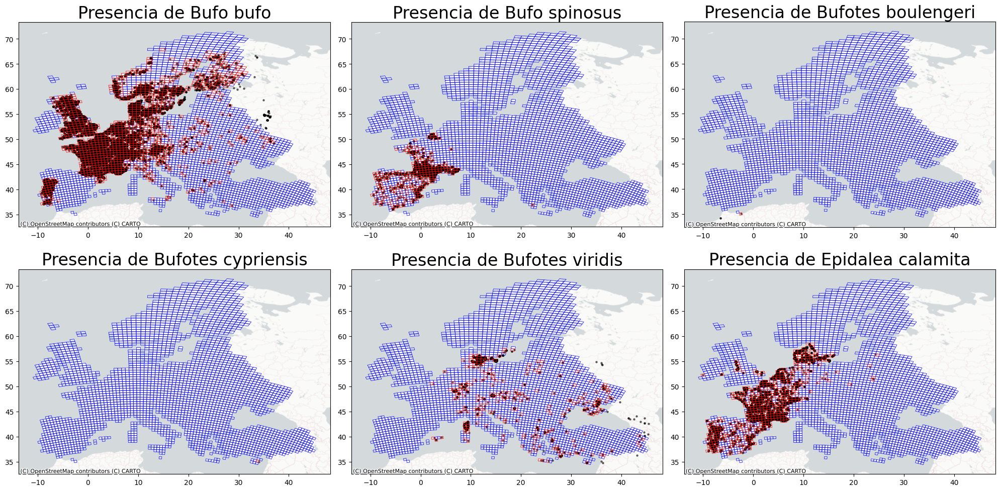
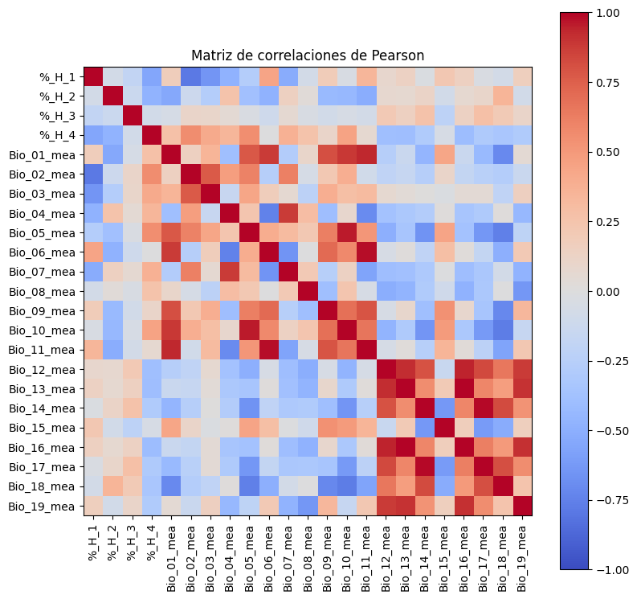
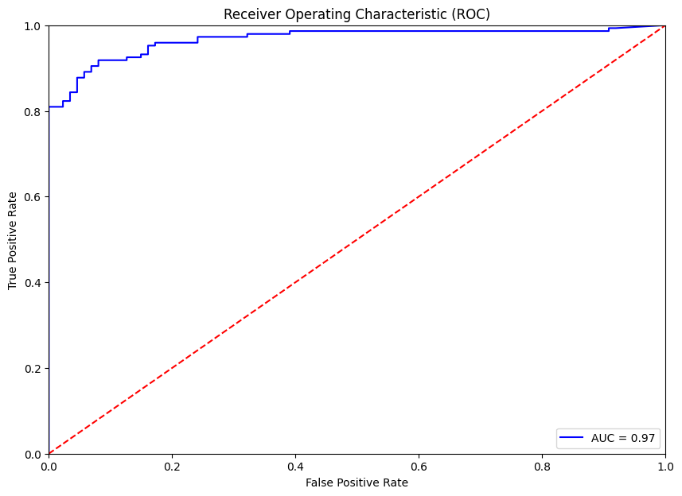
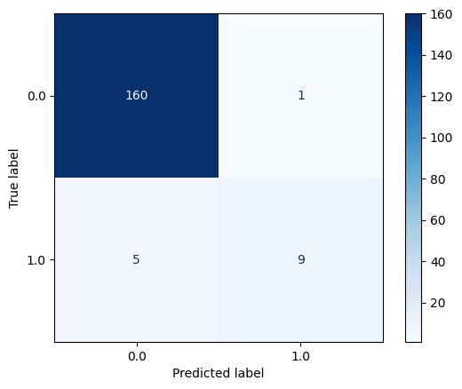
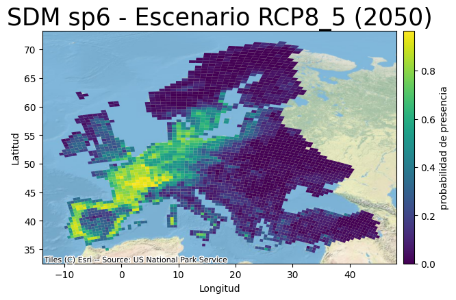
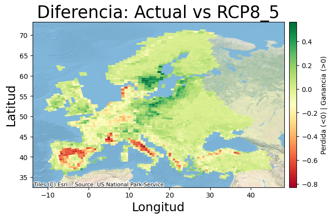

# European Toad Species Distribution Modelling

**[English](README.md)** | [Español](README.es.md)

**Python | R | Machine Learning | Geospatial Analysis**

Master's thesis in Data Science and Business Analytics - IFM Smart Education - September 2024

Author: **Mónica Gómez Vadillo**

An ecological data science project combining biodiversity observations, climate variables and land-use data to model three European toad species with Random Forest classifiers.

> **Project status:** This repository preserves the original code and recorded outputs of a September 2024 Master's thesis. The subsequent presentation refresh adds documentation and extracts existing figures; it does not rerun or scientifically revalidate the models. The 2050 maps are scenario-based model outputs, not validated forecasts of future occupancy. Reproduction requires external data and manual QGIS processing.

[Research & pipeline](#research-question-and-pipeline) - [Historical results](#original-results) - [Notebook guide](#notebook-guide) - [Reproducibility](docs/reproducibility.md) - [Limitations](docs/limitations.md)

## Research question and pipeline

**How do modelled distributions of European Bufonidae differ between a historical baseline and two climate and land-use scenarios for 2050?**

The study explores European occurrence patterns, selects three species with contrasting observed ranges, and compares model outputs across scenarios.

| Species | Identifier | Role in the original comparison |
|---|---|---|
| *Bufo bufo* | sp1 | Broad observed distribution |
| *Bufo spinosus* | sp2 | Restricted observed distribution |
| *Epidalea calamita* | sp6 | Intermediate observed distribution |

These range descriptions reflect the study design; they are not independent measurements of dispersal ability or ecological specialisation.

```text
R / GBIF acquisition
  -> QGIS / European extent
  -> Python / taxonomy, coordinates, dates and duplicates
  -> Python + QGIS / 50 km grid, pseudoabsences and environmental predictors
  -> Python / correlation analysis and feature selection
  -> Random Forest / GridSearchCV and held-out evaluation
  -> Baseline and 2050 model maps / scenario differences
```

## Data sources and scenarios

| Source | Contribution |
|---|---|
| [GBIF occurrence download](https://doi.org/10.15468/dl.rjd4ty) | Bufonidae presence records; download dated 5 July 2024 |
| [CHELSA](https://chelsa-climate.org/) | 19 bioclimatic variables before selection; baseline and future climate inputs |
| [GLOBIO](https://www.globio.info/globio-data-downloads) | Land-use classes aggregated into four habitat proportions |
| [EEA reference grids](https://www.eea.europa.eu/data-and-maps/data/eea-reference-grids-2) | Basis of the European 50 × 50 km grid described in the thesis |

The original download contained **1,544,071 records**. After initial filtering and European selection, **701,265** entered Python cleaning; **86,832** remained after cleaning. These are historical recorded counts, not counts from a new download.

| Repository scenario label | Climate information in the thesis | Land-use scenario |
|---|---|---|
| Current / 2010 | CHELSA 1981–2010 climatology | GLOBIO 2010 |
| RCP2.6 / 2050 | GFDL-ESM4, SSP126 | GLOBIO 2050 SSP1 RCP2.6 |
| RCP8.5 / 2050 | GFDL-ESM4, SSP585 | GLOBIO 2050 SSP5 RCP8.5 |

"Current" is the original historical baseline label. The exact future climatological averaging window and product versions require verification from the original data. See [data provenance and availability](docs/data-sources.md).

## Technologies and skills demonstrated

| Area | Evidence in the project |
|---|---|
| R data acquisition | GBIF API download using `rgbif` |
| Python data preparation | pandas/NumPy filtering, taxonomic checks, temporal alignment and deduplication |
| Geospatial analysis | GeoPandas, Rasterio, Shapely and QGIS; spatial joins, raster masks and zonal statistics |
| Machine learning | scikit-learn Random Forest, hyperparameter search, ROC-AUC and confusion matrices |
| Exploratory analysis | Pearson correlations, hierarchical clustering and variable distributions |
| Scientific communication | Jupyter notebooks, Matplotlib/Seaborn charts and scenario maps |
| Model serialisation | `joblib` export calls; trained model files are external |

This project demonstrates applied data science and ML workflows. It does not include a deployed inference service, MLOps pipeline or production AI system.

## Observed distribution and exploratory analysis



*Original exploratory map of six species, before the final three-species modelling stage. Points represent observations; cells without records are not confirmed absences. OpenStreetMap/CARTO attribution is retained. Source: [notebook 02](02_Procesamiento_espacial_Europa_Bufonidae.ipynb), cell 14.*



*Pearson correlations among 19 bioclimatic variables and four habitat proportions, before feature selection. This is exploratory analysis, not independent model validation. Source: [notebook 06](06_Analisis_variables_independientes.ipynb), cell 18.*

## Original results

**September 2024 outputs - not independently revalidated.**

The models use **12 predictors**: BIO1, BIO2, BIO3, BIO4, BIO5, BIO8, BIO12 and BIO15, plus aquatic, evergreen-tree, deciduous-tree and shrub/grassland habitat proportions. Identifiers and coordinates are excluded from model features.

The implemented evaluation uses an **80/20 random train/test split** (`random_state=0`) and **three-fold GridSearchCV** over 24 configurations. The search uses default classifier accuracy; ROC-AUC is calculated separately on test data. This is not spatial validation.

| Species | Test accuracy: default decision | Test ROC-AUC | Accuracy: probability > 0.60 | Recall: > 0.60 | Precision: > 0.60 |
|---|---:|---:|---:|---:|---:|
| *B. bufo* | 0.91 | 0.96743 | 0.92 | 0.92 | 0.95 |
| *B. spinosus* | 0.97 | 0.98758 | 0.97 | 0.64 | 0.90 |
| *E. calamita* | 0.94 | 0.98565 | 0.93 | 0.85 | 0.95 |

*Values transcribed from stored outputs; AUC rounded to five decimals. Other metrics retain the original two-decimal reporting. The accuracy columns use different decision rules.*

The *B. spinosus* test set contains only **14 positive examples**: 9 true positives and 5 false negatives at the 0.60 threshold. Its high accuracy must be read alongside its lower recall and class imbalance.



*Historical held-out ROC for sp1, with AUC rounded to 0.97 in the figure. This does not establish spatial or future-scenario transferability. Source: [notebook 07](07_SDM_Bufo_bufo.ipynb), cell 62.*



*Rows are true labels; columns are predicted labels. Class 1 denotes presence and class 0 pseudoabsence. At probability > 0.60: TN=160, FP=1, FN=5, TP=9. Only 14 test examples are positive, so accuracy must be interpreted alongside recall and class imbalance. Source: [notebook 08](08_SDM_Bufo_spinosus.ipynb), cell 66.*

## Scenario visualisations



*Original sp6 output under the scenario labelled RCP8.5 (2050). The "probability of presence" legend is preserved; these scores have not been independently calibrated as occupancy probabilities. Esri/US National Park Service credits are retained. Source: [notebook 09](09_SDM_Epidalea_calamita.ipynb), cell 113.*



*Future model score minus baseline score. Negative values indicate lower scores, not confirmed local extinction. Esri/source credits and the original colour scale remain unchanged; the scale is not explicitly centred on zero. Source: [notebook 12](12_Diff_SDM_Epidalea_calamita%20.ipynb), cell 28.*

The thesis interprets the maps as suggesting species-specific changes, including southern declines and some northern gains. These interpretations remain subject to [methodological limitations](docs/limitations.md), particularly inconsistent scaling between training and inference.

All **six original exported figures** shown here are also in the [figure catalogue](docs/figures.md), with notebook/cell provenance and SHA-256 hashes. Cell numbers count all cells, including Markdown, starting at 1. The PNGs are displayed unchanged from `docs/figures/`.

## Notebook guide

Names and locations are retained to preserve the original workflow.

| File | Purpose |
|---|---|
| [00 - R acquisition](00_Download_GBIF.R) | GBIF download and initial filters |
| [01 - Occurrence cleaning](01_Bufonidae.ipynb) | Taxonomy, coordinates, dates and duplicates |
| [02 - Spatial processing](02_Procesamiento_espacial_Europa_Bufonidae.ipynb) | Grid aggregation and observed distributions |
| [03 - Baseline predictors](03_Procesamiento_Escenario_Actual_GLOBIO_2010.ipynb) | GLOBIO processing and CHELSA integration |
| [04 - RCP2.6 predictors](04_Procesamiento_Escenario_Futuro_RCP2.6.ipynb) | Future environmental inputs |
| [05 - RCP8.5 predictors](05_Procesamiento_Escenario_Futuro_RCP8.5.ipynb) | Future environmental inputs |
| [06 - Variable analysis](06_Analisis_variables_independientes.ipynb) | Correlations and selection |
| [07 - Bufo bufo](07_SDM_Bufo_bufo.ipynb) | Model, evaluation and projections |
| [08 - Bufo spinosus](08_SDM_Bufo_spinosus.ipynb) | Model, evaluation and projections |
| [09 - Epidalea calamita](09_SDM_Epidalea_calamita.ipynb) | Model, evaluation and projections |
| [10 - Bufo bufo differences](10_Diff_SDM_Bufo_bufo.ipynb) | Scenario differences |
| [11 - Bufo spinosus differences](11_Diff_SDM_Bufo_spinosus.ipynb.ipynb) | Scenario differences |
| [12 - Epidalea calamita differences](12_Diff_SDM_Epidalea_calamita%20.ipynb) | Scenario differences |

## Reproducibility and limitations

**A clone alone cannot reproduce the analysis.** Data, trained models, the original environment export and manual QGIS outputs are not included. Some relative paths are inconsistent and some intermediate exports are commented out.

Documented historical tools: **Python 3.12.4**, **R 4.3.3**, **QGIS 3.32.3-Lima**. Package versions are not fully recoverable from tracked files; no newly verified environment is claimed.

The technical review identifies four central risks:

- Scaling is computed before splitting and recomputed independently for inference datasets.
- Random splitting and cross-validation do not assess spatial independence.
- Pseudoabsences were generated manually, with an angular buffer and no recorded random seed.
- Habitat areas are calculated in a geographic CRS; joins require cardinality checks.

Scientific files and outputs remain unchanged. Read [methodology](docs/methodology.md), [reproducibility and dependencies](docs/reproducibility.md), [limitations](docs/limitations.md) and [thesis/code discrepancies](docs/discrepancies.md).

## Academic context, authorship and attribution

**Mónica Gómez Vadillo** developed this project for the Master's in Data Science and Business Analytics at **IFM Smart Education**, September 2024. Thesis: *Modelo de distribución de especies (SDM) para bufónidos europeos del orden Anura*. Supervisors named in the thesis: Abel Soriano Vázquez and Juan Manuel Moreno Lamparero.

The thesis PDF is not distributed in this repository. GBIF, CHELSA, GLOBIO, the EEA grid and basemap providers retain their respective attribution and licensing requirements. **No code licence has been selected or added.** See the [licensing recommendation](docs/licensing-recommendation.md) for the decision pending author review.
