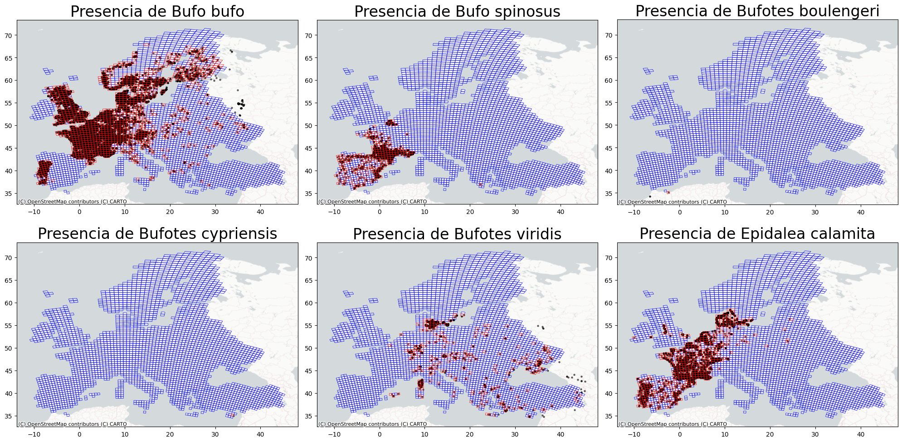
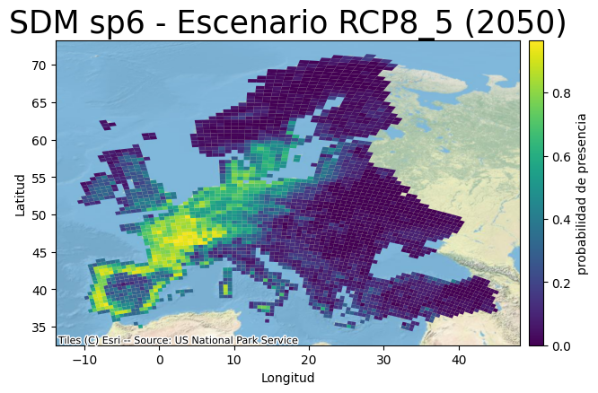
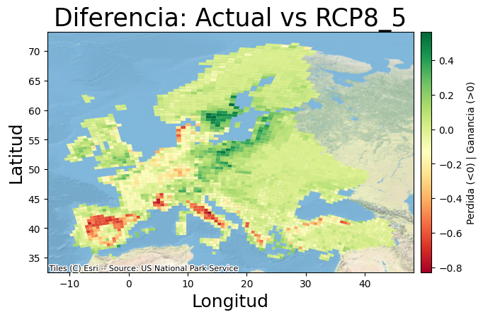
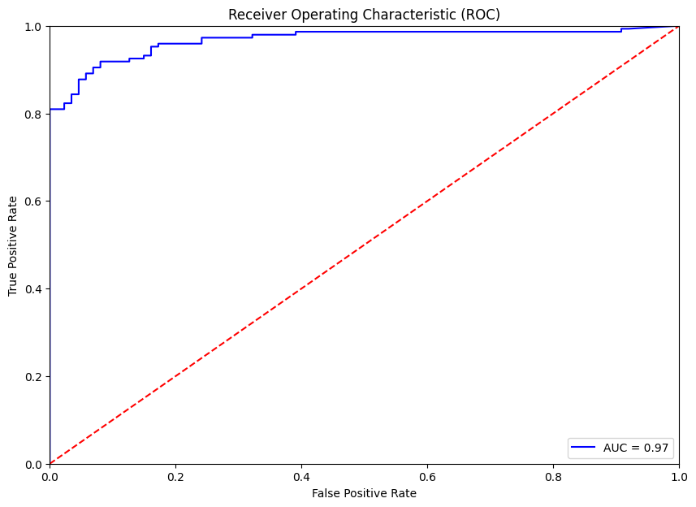
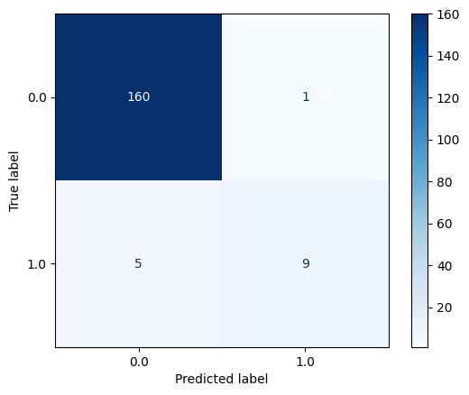
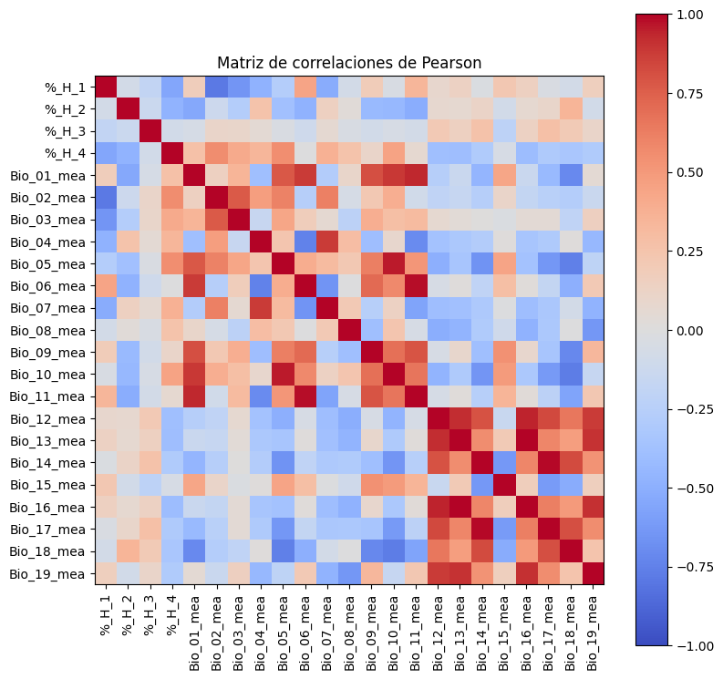

# Original figure catalogue

[Project overview](../README.md) · [Interpretation limits](limitations.md#visual-interpretation) · [Machine-readable provenance](figures/provenance.json)

These six PNGs are decoded directly from existing notebook `image/png` outputs. No cells were executed and no models were retrained. Image pixels, dimensions, labels, colour scales and embedded cartographic attribution are unchanged. Cell numbers are **1-based and include Markdown cells**; output indices in the manifest are 0-based.

| Export | Source notebook | Cell | Dimensions |
|---|---|---:|---|
| [Observed distributions](figures/observed-species-distributions.png) | [02](../02_Procesamiento_espacial_Europa_Bufonidae.ipynb) | 14 | 1989 × 977 |
| [sp6 / 2050 RCP8.5](figures/epidalea-calamita-2050-rcp85.png) | [09](../09_SDM_Epidalea_calamita.ipynb) | 113 | 666 × 438 |
| [sp6 / RCP8.5 minus baseline](figures/epidalea-calamita-change-rcp85.png) | [12](../12_Diff_SDM_Epidalea_calamita%20.ipynb) | 28 | 682 × 448 |
| [sp1 / test ROC](figures/bufo-bufo-test-roc.png) | [07](../07_SDM_Bufo_bufo.ipynb) | 62 | 857 × 624 |
| [sp2 / confusion matrix](figures/bufo-spinosus-confusion-matrix.png) | [08](../08_SDM_Bufo_spinosus.ipynb) | 66 | 520 × 438 |
| [Predictor correlations](figures/predictor-correlations.png) | [06](../06_Analisis_variables_independientes.ipynb) | 18 | 793 × 745 |

All six figures appear in both the [English README](../README.md) and the [Spanish README](../README.es.md). The manifest records a SHA-256 hash for each exported file, enabling comparison with its original notebook output.

## Observed distributions

Shows six taxa considered before the final model selection. It is an observation map, not a six-model prediction panel. Cells without observations are not verified absences. Embedded attribution: OpenStreetMap contributors and CARTO.

## Scenario output for Epidalea calamita

The original sp6 identifier denotes *Epidalea calamita*. The model-score legend and historical scenario label are retained. Embedded credit identifies Esri and the US National Park Service. The map is not an independently validated forecast.

## Future-minus-baseline difference

Values equal RCP8.5 scores minus baseline scores. The unchanged diverging colour range is not explicitly centred on zero. Retain the Esri/source attribution; interpret score changes rather than confirmed gains or losses of occupancy.

## Bufo bufo ROC

Historical random-holdout ROC, displaying AUC rounded to 0.97. The stored numeric AUC is 0.9674329501915708.

## Bufo spinosus confusion matrix

Rows are true labels and columns predicted labels. Class 1 is presence and class 0 is pseudoabsence. At probability > 0.60 the counts are TN=160, FP=1, FN=5, TP=9. The figure is unchanged; these labels correct the interpretation in the original prose, not the matrix itself.

## Predictor correlations

Historical Pearson correlation map for 19 bioclimatic predictors and four habitat proportions, before feature selection. It documents exploratory analysis, not independent model validation.

## Publication review

The six images were visually inspected for personal filesystem paths, credentials and personal identifiers. None were apparent. The map images retain visible provider credits. This inspection does not certify all third-party licence conditions; [licensing review](licensing-recommendation.md) remains separate. Original notebook tables and warning outputs may still contain recorder information and personal paths, and were deliberately left unchanged.
